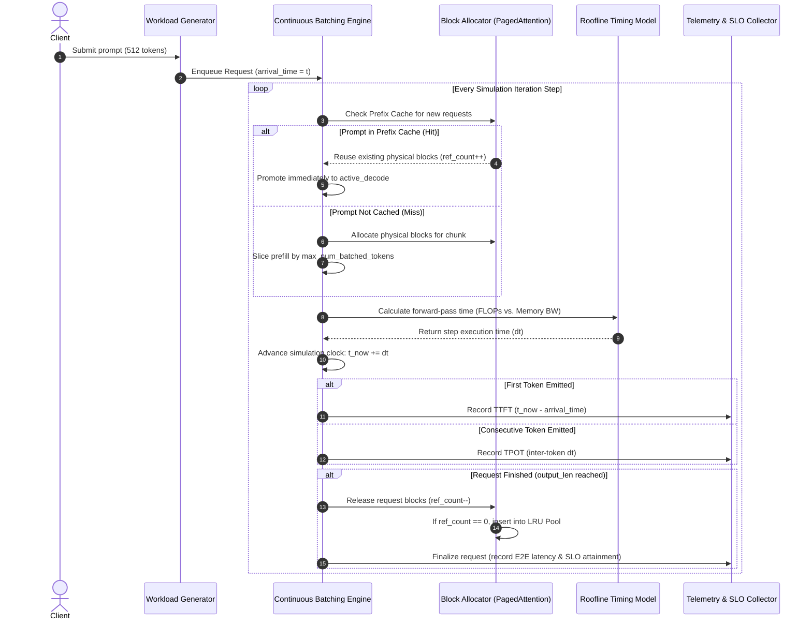

# High-Level Design (HLD): LLM Serving Simulator & Capacity Planner

---

## 1. Executive Summary & Purpose

`llm-serving-sim` is a discrete-event simulator and capacity planning engine modeled after modern GPU inference serving stacks (specifically **vLLM** and **TensorRT-LLM**). 

### Primary Objectives:
1. **Accurate Performance Modeling**: Predict Time-To-First-Token (TTFT), Time-Per-Output-Token (TPOT), and Goodput without executing real deep learning weights on physical GPUs.
2. **Algorithmic Evaluation**: Quantify the latency and throughput trade-offs of modern serving optimizations:
   - Chunked Prefill token budgets (`max_num_batched_tokens`).
   - PagedAttention block allocation with prefix caching and $O(1)$ LRU eviction.
   - Continuous vs. Static batching under bursty Poisson traffic.
3. **Rigorous Capacity Planning**: Bridge classical telecom queueing theory ($M/M/c$ Erlang-C) with GPU hardware rooflines to determine the exact number of GPUs required to satisfy strict enterprise latency SLOs.

---

## 2. System Architecture Decomposition

The system is decomposed into six modular components, cleanly decoupled by mathematical and behavioral contracts:

```
┌─────────────────────────────────────────────────────────────────────────────┐
│                             llm-serving-sim                                 │
├─────────────────────────────────────────────────────────────────────────────┤
│                                                                             │
│  [ Workload Layer ]                                                         │
│     └── workload.py        Poisson arrival generator, lognormal length      │
│                            distributions, shared prefix tagging.            │
│                                                                             │
│  [ Memory Management Layer ]                                                │
│     └── kvcache.py         PagedAttention physical block allocator,         │
│                            64-bit cryptographic prefix hashing,             │
│                            O(1) OrderedDict LRU eviction pool.              │
│                                                                             │
│  [ Hardware Execution Layer ]                                               │
│     └── timing.py          Williams & Patterson Roofline model              │
│                            (Compute FLOPs vs HBM3 Memory Bandwidth).        │
│                                                                             │
│  [ Scheduling & Runtime Layer ]                                             │
│     └── engine.py          Discrete-event continuous batching runtime,      │
│                            token-budget chunked prefill scheduler,          │
│                            recompute-style preemption handler.              │
│                                                                             │
│  [ Observability & Telemetry Layer ]                                        │
│     └── metrics.py         Per-request telemetry tracker, tail latency      │
│                            percentiles (P50, P90, P99), SLO Goodput.        │
│                                                                             │
│  [ Capacity & Sizing Layer ]                                                │
│     └── planner.py         Telecom Erlang-C (M/M/c) log-space queueing      │
│                            solver, cluster sweep, divergence analysis.      │
│                                                                             │
└─────────────────────────────────────────────────────────────────────────────┘
```

---

## 3. End-to-End Request Lifecycle & Flow

The following sequence diagram illustrates the lifecycle of a request from arrival to completion through the discrete-event continuous batching engine:



---

## 4. Subsystem Roles & Responsibilities

### 4.1. Workload Generator (`workload.py`)
- Models real-world production traffic distributions:
  - **Inter-arrival times**: Exponentially distributed (Poisson process with parameter $\lambda = \text{QPS}$).
  - **Prompt and output lengths**: Lognormal distributions truncated to model realistic context variance.
  - **Prefix correlation**: Assigns cluster-wide shared system prompts (`prefix_id`, `prefix_len`) to emulate multi-turn agentic conversations and RAG workflows.

### 4.2. Paged KV Cache Manager (`kvcache.py`)
- Emulates the operating-system-style virtual memory paging introduced in vLLM:
  - Partitions GPU VRAM into fixed physical pages (default: 16 tokens/block).
  - Maintains logical-to-physical page mapping tables per request.
  - Chains block content hashes for prefix matching.
  - Maintains an $O(1)$ LRU evictable pool for unreferenced blocks (`ref_count == 0`), reclaiming memory only when physical capacity saturates.

### 4.3. Roofline Timing Engine (`timing.py`)
- Hardware physics model evaluating fused execution steps:
  - Determines whether an iteration is **Compute-bound** (prefill-dominated matrix multiplication) or **Memory-bound** (decode-dominated HBM3 streaming).
  - Models realistic kernel launch overhead and hardware efficiencies.

### 4.4. Continuous Batching Runtime (`engine.py`)
- Iteration-level discrete-event scheduler:
  - Implements **Chunked Prefill**: Breaks long prompts into token chunks (e.g., 512 tokens), interleaving prompt evaluation with running decode steps to eliminate decode jitter.
  - Handles **Memory Preemption**: If physical blocks are exhausted, pauses low-priority requests, frees their blocks, and recomputes them once memory pressure subsides.

### 4.5. Capacity Planner (`planner.py`)
- Enterprise hardware sizing and verification engine:
  - Calculates offered traffic in Erlangs: $A = \lambda \cdot E[S]$.
  - Solves the classical $M/M/c$ Erlang-C delay probability equation using log-space arithmetic.
  - Sweeps cluster sizes against simulated continuous batching to detect the exact sizing knee and hardware consolidation dividends.

---

## 5. Hardware & Model Specifications

The default baseline represents modern standard enterprise serving:

| Dimension | Specification | Notes |
|---|---|---|
| **GPU Target** | NVIDIA H100 SXM5 | 80 GB HBM3, 3.35 TB/s Bandwidth, 989 TFLOP/s FP16 Peak |
| **Model Target** | Meta Llama-3-8B | 8.03B parameters, GQA (8 KV heads), 32 layers, hidden size 4096 |
| **Weight Footprint** | 16.03 GB | FP16/BF16 format (2 bytes/param) |
| **KV Cache Capacity** | 57.57 GB | 28,785 physical blocks (460,560 tokens max pool) |
| **Default SLO** | TTFT < 500 ms, TPOT < 50 ms | 99th percentile target for enterprise interactive chat |
